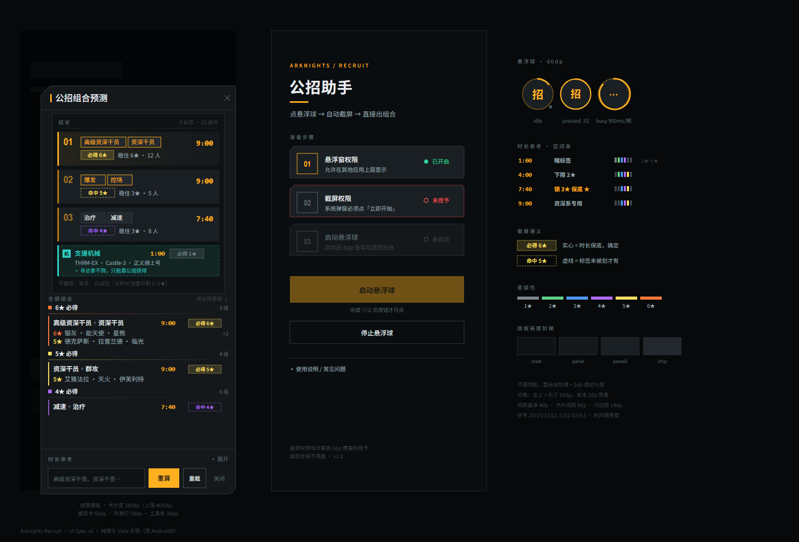
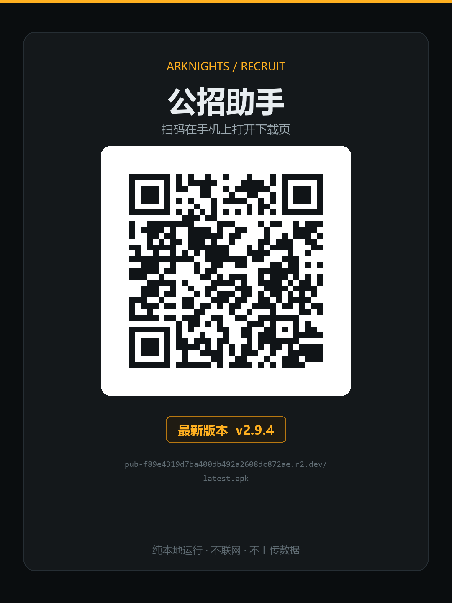

# 公招助手 · Arknights Recruit Helper

《明日方舟》公开招募标签助手（Android）。在公招界面点一下悬浮球，自动截屏、识别 5 个标签，
算出所有 1~3 标签组合的**必出星级**，直接告诉你选哪几个、挂多长时间。

**纯本地运行：不联网、不上传任何数据、不碰游戏进程（不自动点击）。**



---

## 功能

- **一键识别**：点悬浮球 → 截屏 → 定位标签按钮 → OCR → 出结论，全程约 1~2 秒
- **不用维护坐标**：按「深色长条 + 多行同列对齐」的几何特征找按钮，换分辨率、曲面屏、
  折叠屏、横竖屏都能跟；找不到就退回整屏 OCR
- **口径区分保底与赌注**：清楚区分「时长保底」（标签全被划也至少拿到）
  与「标签命中」（有风险），不把上限当保底忽悠你
- **可手动修正**：OCR 认错时面板里有输入框，改完点「重算」
- **arm64（64 位 ARM）**，不需要 Google 服务框架，15.5 MB

## 安装



1. 手机扫码，或直接打开下载地址：

   **国内推荐**：<https://pub-f89e4319d7ba400db492a2608dc872ae.r2.dev/latest.apk>
   （Cloudflare R2，实测约 275 KB/s）

   **境外 / 看版本说明**：[Releases](https://github.com/TttMc/arknights-recruit-helper/releases/latest)
   （GitHub，境内直连只有约 17 KB/s，15 MB 要下十几分钟，不建议）

2. 手机允许「安装未知来源应用」后安装
3. 打开 App，依次完成三步：

| 步骤 | 说明 |
|---|---|
| ① 开启悬浮窗权限 | 系统设置里的「显示在其他应用上层」 |
| ② 授予截屏权限 | 系统弹「开始录制或投放您的屏幕」，点「立即开始」 |
| ③ 启动悬浮球 | 出现「招」字圆球，App 退到后台 |

4. 回到游戏，进「公开招募 → 新建招募」页，点悬浮球

> **截屏权限是临时的**：每次重启 App 都要重新点一次 ②。这是 Android 的系统限制，
> 所有录屏类应用都一样，不是本应用的设计缺陷。

**升级**：签名一致，直接在旧版上覆盖安装即可，**不用先卸载**
（卸载会清掉悬浮窗与截屏授权，得重新走一遍 ①②③）。

系统要求：**Android 8.0（API 26）及以上**。

## 判定口径

游戏规则决定了怎么算：

- 一次最多选 **3 个标签**，所以只枚举 1~3 标签的组合
- **「必出」= 同时命中该组合全部标签的干员中，最低的星级**
- 招募时长会抬高星级下限，且标签可能被系统划掉：

| 时长 | 可能出现的星级 |
|---|---|
| 1:00 | 1~4★ |
| 4:00 | 2~5★ |
| 7:40 | 3~5★ |
| 9:00 | 3~5★；带「资深干员」必得 5★、带「高级资深干员」必得 6★ |

所以真正的保底来自**时长**（标签被划也不亏的那部分），标签只是在此之上的收窄。
「资深干员 / 高级资深干员」是唯一不会被划掉的标签，因此 9:00 下是确定的保底。

「最高」是该组合里星级最高的候选，只是上限，**不保底**。

## 技术实现

```
MainActivity          权限引导、版本与更新入口
  └─ OverlayService   悬浮球 + 结果面板 + 截屏（MediaProjection）
       ├─ TagFinder   降采样 → 二值化 → 连通域 → 标签组定位 → ML Kit OCR → 纠错
       └─ Recruit     组合枚举、必出/上限/时长保底计算
```

### 为什么先找按钮再 OCR

整屏 OCR 对游戏里「深色块 + 白字」的小字很不友好，实测只能认出 3~4 个/5 个。
把按钮裁出来、放大 2~4 倍再识别，命中率明显更高。

`TagFinder.findDarkBars()`：

1. 按**短边**降采样到约 320（横竖屏下按钮在采样图上的尺寸才一致）
2. 亮度 < 95 二值化，4 邻接 flood fill（显式栈，不会递归溢出）
3. 按宽度、高度、长宽比 1.4~7.0、填充率 > 50% 过滤
4. 挑出「多行 × 列起点对齐」的那一组 —— 招募时限的上下箭头、顶部状态虽然尺寸相似，
   但不会成组

OCR 侧对每个按钮做多档重试（2x / 3x / 1.5x / 反色增强 / 4x），
识别结果再经过编辑距离、包含、有序子序列等规则纠错。原则是
**宁可少认，不能认错**：命中不唯一就放弃，绝不给一个凭空的 6★ 结论。

### OCR 选型

[ML Kit 中文文字识别](https://developers.google.com/ml-kit/vision/text-recognition/v2/android)
（`com.google.mlkit:text-recognition-chinese:16.0.1`）：

- 中文模型随 APK 打包，**首次使用也不需要联网**
- 不需要 Google 服务框架
- 识别器在进程内复用，不每次点球都重新初始化

对比过：Android 没有公开的系统级中文 OCR API；自己打包 PP-OCR 要多塞 20MB+ 模型和推理引擎，更重。

### 权限（只有 4 条，全部必要）

| 权限 | 用途 |
|---|---|
| `SYSTEM_ALERT_WINDOW` | 悬浮球 |
| `FOREGROUND_SERVICE` + `FOREGROUND_SERVICE_MEDIA_PROJECTION` | 截屏必须挂前台服务（Android 14 起要求显式类型） |
| `POST_NOTIFICATIONS` | Android 13+ 的前台服务通知 |

**没有 `INTERNET`，也没有 `ACCESS_NETWORK_STATE`。**

ML Kit 的传递依赖 `com.google.android.datatransport:transport-backend-cct` 会往合并后的
manifest 里塞这两条。本应用用 `tools:node="remove"` 显式移除，可以自行验证：

```bash
aapt dump permissions build/outputs/apk/release/*.apk
```

结果应只有上面 4 条，外加系统自动生成的 `DYNAMIC_RECEIVER_NOT_EXPORTED_PERMISSION`。

因为这个约束，App 内**不会自动检查更新**——「下载最新版」按钮只是把下载地址交给
系统浏览器打开（真正发请求的是浏览器进程，本应用只递了个字符串），
App 自身一个字节都不联网。

## 构建

需要 JDK 17、Android SDK（platform 34 + build-tools 34.0.0）。

```bash
git clone https://github.com/TttMc/arknights-recruit-helper.git
cd arknights-recruit-helper

export ANDROID_HOME=/path/to/Android/Sdk     # Windows: set ANDROID_HOME=...

./gradlew assembleRelease        # Windows: gradlew.bat assembleRelease
```

产物：`build/outputs/apk/release/ArknightsRecruit-release.apk`

不需要单独装 Gradle，`gradlew` 会自动下载（`gradle/wrapper/gradle-wrapper.properties`
默认指向腾讯云镜像，境外网络可换回 `services.gradle.org`）。

### 签名

默认**没有**签名配置，`assembleRelease` 会退回 debug 签名（能装，但不能用于正式分发）。

自建签名优先级（高到低）：

1. 环境变量 `ARK_STORE_FILE` / `ARK_STORE_PASSWORD` / `ARK_KEY_ALIAS` / `ARK_KEY_PASSWORD`
2. 项目根的 `keystore.properties`（模板见下，已在 `.gitignore`）

```properties
storeFile=release.keystore
storePassword=你的口令
keyAlias=你的别名
keyPassword=你的口令
```

> ⚠️ **签名密钥一定要单独备份**。一旦丢失，已装用户永远无法覆盖升级，只能卸载重装。
> 仓库里不含任何 keystore 与口令。

### 传到手机上（局域网安装，不用数据线）

```bash
build-and-serve.cmd            # 编译 + 起本地服务，端口 8000
build-and-serve.cmd 8080       # 换端口
build-and-serve.cmd --serve    # 只起服务，不重新编译
```

控制台会打印手机要打开的地址（形如 `http://192.168.x.x:8000/`）。手机连同一个 WiFi
用浏览器打开即可下载安装。装过一次后地址固定为 `http://<电脑IP>:8000/latest.apk`，
可以存成书签。

只读服务，只暴露 `build/outputs/apk/release/*.apk`，不列目录、不接受上传。

### 发布到公网

两条腿：GitHub 存代码与版本归档，Cloudflare R2 供国内下载。

```bash
# 1. 传 APK 到 R2（会同时更新 latest.apk 和 update.json）
R2_ACCOUNT_ID=... R2_ACCESS_KEY_ID=... R2_SECRET_ACCESS_KEY=... \
R2_BUCKET=tmc-pj-01 R2_PUBLIC_BASE=https://pub-xxxx.r2.dev \
node tools/publish-r2.mjs

# 2. 重新生成二维码卡片
python tools/make-qr.py --version v2.9.5
```

`publish-r2.mjs` 只依赖 Node 内置模块，自己实现了 AWS SigV4 签名，不需要装 AWS SDK。

**为什么默认走 R2**：实测同一台机器、同一个包，
GitHub 约 **17 KB/s**（15 MB 要下十几分钟还常断），R2 约 **275 KB/s**，快 16 倍。
GitHub 仍然是源码和版本说明的正式入口，R2 只是下载镜像。

> R2 免费额度：10 GB 存储 + 出网流量全免费，单对象最大 5 TB。
> 代价是要在 Cloudflare 绑一个支付方式（Free 计划不扣钱）。

### 算法回归测试

`Recruit` 不依赖任何 Android 类，可以脱 SDK 单独编译测试：

```bash
# 跑法见 tools/algotest/README.md，21 条断言，覆盖必出星级与特殊标签
```

## 干员数据

在 `res/values/operators.xml`，格式 `名字|稀有度|标签1,标签2,...`。

当前按 **2026-08-01** 的公开招募池维护，已对照 PRTS 官方 wiki 逐条核对：
资深干员 5★ 池 52/52 命中、高级资深干员 6★ 池 35/35 命中。

更新数据时注意**只收公开招募池里的干员**。例如稀音是活动/凭证交易所获取、
深海色只在寻访池，都不该收录；收录了会让「必出」算错。改完重编译即可，不用改代码。

## 已知限制

- **截屏权限每次重启 App 都要重授**（Android 系统限制）
- **不自动点击**：只识别和计算，选哪个标签你自己点，这样也不会碰游戏进程
- **识别依赖标签按钮是深色**：如果游戏改浅色主题，`TagFinder` 里的
  `lum < 95` 阈值需要调整
- **横屏帧方向未在所有机型验证**：`InputImage` 的 rotation 恒传 0。
  若某机型交上来的帧本身转了 90°，会表现为「没识别到标签」
- **干员数据是静态快照**，新干员进池后需要手动更新（见上）
- **只支持 arm64**：为了把体积从 22 MB 降到 15.5 MB，去掉了 32 位 ARM 的库。
  2016 年前的 32 位设备装不上；要兼顾的话在 `build.gradle` 里加回
  `abiFilters 'arm64-v8a', 'armeabi-v7a'`

## 免责声明

本项目为个人向的辅助工具，与鹰角网络（Hypergryph）无关，不含任何游戏资源文件。
它只做屏幕识别与本地计算，**不修改游戏数据、不自动操作、不注入游戏进程**。
使用第三方工具可能违反游戏用户协议，请自行评估风险。

## 许可

[MIT](LICENSE)
